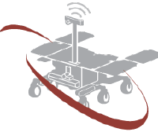

# SINTEF Reliable Automation

Welcome to the GitHub organization for the Reliable Automation group at SINTEF Digital.
Read more about our group on our [webpage](https://www.sintef.no/en/digital/departments/mathematics-and-cybernetics/reliable-automation/).

## Open Source Software

As a part of our contract research, we develop open source software. <!-- These are both developed by our group at SINTEF and in collaboration with industry, academia and other research institutions.--> Please see the respective webpages listed below for additional details.

| Software | Description |
|------|-------------|
| [Argus ](https://github.com/SINTEF/Argus) | A standalone DJI Payload SDK application that combines data streams from sensors and DJI drones and combines into a single, fused log. A selection of fields can also be forwarded to the pilot for real-time monitoring during flight. It is currently designed for a Raspberry Pi payload computer, a future expansion to Manifold3 is planned. |
| [I3DS ](https://github.com/I3DS) | A modular sensor suite was initially developed within the [I3DS project](https://www.sintef.no/en/projects/2016/i3ds/) and subsequently reused and further enhanced in the [EROSS projects](https://www.sintef.no/en/projects/2018/eross-european-robotic-orbital-support-services/). |
| [STARS Tools ](https://github.com/henrikau/stars_tools) | Python script tools supporting the [STARS project](https://www.sintef.no/en/projects/2026/stars-space-based-topology-and-routing-study/), "Space-based Topology And Routing Study", led by SINTEF. |
| [NetChan ](https://github.com/henrikau/net_chan) | C/C++ library for reliable, or deterministic network channel (NetChan) - a logical construct that can be added to a distributed system to provide deterministic and reliable connections via TSN. |
| [liburx](https://github.com/henrikau/libURX) | C++ library for connecting to a Universal Robots Controller. |
| [XInTheLoop Library](https://github.com/Virtual-FCS/XInTheLoop) | A Modelica library for real-time exchange of signals between a running simulation and external systems (typically hardware) was developed as part of the [Virtual-FCS](https://www.sintef.no/en/projects/2020/virtual-fcs-virtual-physical-platform-for-fuel-cell-system-development/) and [StasHH](https://www.sintef.no/en/projects/2021/stashh/) projects. |

We have also contributed to open source software maintained by others.

| Software | Description |
|------|-------------|
| [VirtualFCS](https://github.com/Virtual-FCS/VirtualFCS) | An open Modelica library for dynamic modelling of hydrogen and hybrid energy systems. It brings together electrochemical, electrical, fluid, thermal, control, and vehicle models, with examples ranging from PEM fuel cell vehicles to ammonia cracking. It was initially developed within the [Virtual-FCS project](https://www.sintef.no/projectweb/virtual-fcs/) and further enhanced in several projects later. |
| [AutoActive-ActivityPresenter](https://github.com/SINTEF/AutoActive-ActivityPresenter) | The main visualization tool in [AutoActive Research Environment](https://www.sintef.no/projectweb/autoactive/software-platform/) (ARE). ARE was developed in the research project [AutoActive](https://www.sintef.no/projectweb/autoactive/) to enable easy handling (synchronization, visualization, analysation) of sensor data from different commercially available wearable sensors for human activity and video. |

<!-- Hidden for now, but might be needed later:
## Contact

Please contact [Kristoffer Nyborg Gregertsen](mailto:kristoffer.gregertsen@sintef.no), Research Manager.
-->

